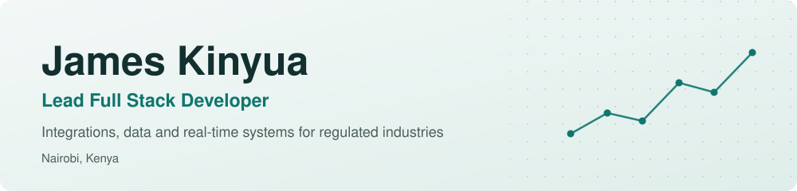

<picture>
  <source media="(prefers-color-scheme: dark)" srcset="./img/banner-dark.svg">
  <source media="(prefers-color-scheme: light)" srcset="./img/banner-light.svg">
  
</picture>

  <a href="https://linkedin.com/in/james-kinyua00"><b>LinkedIn</b></a> &nbsp;·&nbsp;
  <a href="mailto:jameskinyua190@gmail.com"><b>Email</b></a> &nbsp;·&nbsp;
  <a href="#live-systems"><b>Live systems</b></a> &nbsp;·&nbsp;
  <a href="#public-projects"><b>Public projects</b></a>

I lead a team of 10 developers at Agile Business Solutions and stay hands-on in the code. Over 7+ years I've built platforms for a national financial regulator, the Nairobi Securities Exchange, SACCOs, county government and international health organisations.

My work sits where reliability matters: live market data, payments, regulatory reporting and integrations with national systems.

<table>
  <tr>
    <td align="center" width="25%"><h3>10,000+</h3>student users on NSE Virtual Trader, about 2,000 active daily</td>
    <td align="center" width="25%"><h3>~300</h3>SACCOs onboarded to the regulator's supervisory system</td>
    <td align="center" width="25%"><h3>~0.2%</h3>dropped market feed packets after the Go rewrite I led</td>
    <td align="center" width="25%"><h3>3</h3>countries where the staff portal I built for AMREF was rolled out</td>
  </tr>
</table>

## Live systems

Production systems I built or helped build. Most sit behind a login, so the links open the sign-in or landing page.

| System | What it does | My part |
|---|---|---|
| **[NSE Virtual Trader / SOKO PLAY](https://academy.nse.co.ke)** | Investor-education trading platform for the Nairobi Securities Exchange, streaming live market data | Led development; led the Go rewrite of the market feed |
| **[SASRA Risk-Based Supervisory System](https://sacco.sasra.go.ke)** | Regulatory returns, validation and risk scoring for Kenya's SACCO regulator, with KRA eTIMS invoicing | Built the platform and its eTIMS and ERP integrations |
| **[NSE Quotations Board](https://bondsquotations.nse.co.ke)** | Reporting and publishing of bank bond quotes for the secondary market | Built the platform |
| **[Britam Pension Member Portal](https://pensionmembers.britam.com)** | Self-service access to pension accounts for members | Contributed to development |
| **[Mhasibu SACCO Member Portal](https://members.mhasibusacco.com)** | Member accounts, loans and online transactions, with M-Pesa, PayPal, CRB and IPRS | Built the portal and its integrations |
| **[Ushuru SACCO Member Portal](https://webportal.ushurusacco.com:8060/site/login)** | Member balances, statements and loans | Built the portal and its integrations |
| **[Uasin Gishu County Revenue System](https://revenue.uasingishu.go.ke)** | County e-services for licensing, revenue collection and payments | Developed the system |

**Also delivered (internal staff systems, not public):** Employee Self-Service portals on Dynamics 365 Business Central for AMREF Health Africa, IITA Nigeria, The Global Fund Indonesia and KEMRI Wellcome Trust Research Programme.

## Public projects

Code you can read.

| Project | What it is | Stack |
|---|---|---|
| **[Kenya Food Prices and Inflation Platform](https://github.com/jimkinyua/kenya-food-market-analytics)** | End-to-end data platform: 28,463 price records for 51 commodities across 226 markets since 2006, with a star schema, automated quality checks and Grafana geomaps | Python, Airflow, PostgreSQL, Grafana |
| **[JobRadar](https://github.com/jimkinyua/JobRadar)** | Job ingestion and alerting pipeline that collects roles from APIs, feeds and scrapers, removes duplicates, scores them and sends Telegram alerts | Python, PostgreSQL, Gemini |
| **[DocuHelp](https://github.com/jimkinyua/DocuHelp)** | RAG service that answers questions from uploaded PDF, DOCX and TXT files | FastAPI, ChromaDB, Groq, OpenAI, Gemini |
| **[Weather and Crypto ETL Pipeline](https://github.com/jimkinyua/etl-pipeline)** | Extracts API data, normalizes it and loads it into two different databases | Python, PostgreSQL, Cassandra |
| **[Mini Ticket Tracker](https://github.com/jimkinyua/LodwarServices)** | Support ticket API and operations dashboard with integration tests | TypeScript, Express, Prisma, React |
| **[Social Assistance Information System](https://github.com/jimkinyua/SAIS)** | Applicant, officer and programme management with a county-to-village hierarchy | ASP.NET Core MVC, EF Core, SQL Server |

## What I work with

<table>
  <tr><td><b>Languages</b></td><td><code>C#</code> <code>Python</code> <code>Go</code> <code>PHP</code> <code>JavaScript</code> <code>TypeScript</code> <code>SQL</code></td></tr>
  <tr><td><b>Frameworks</b></td><td><code>ASP.NET Core</code> <code>Django</code> <code>Flask</code> <code>FastAPI</code> <code>Laravel</code> <code>React</code> <code>Angular</code></td></tr>
  <tr><td><b>Integrations</b></td><td><code>REST</code> <code>SOAP</code> <code>Kafka</code> <code>M-Pesa</code> <code>IPRS</code> <code>eCitizen</code> <code>KRA eTIMS</code> <code>CRB</code> <code>Business Central</code></td></tr>
  <tr><td><b>Data</b></td><td><code>SQL Server</code> <code>PostgreSQL</code> <code>MySQL</code> <code>Cassandra</code> <code>Airflow</code> <code>ETL/ELT</code> <code>Grafana</code></td></tr>
  <tr><td><b>Cloud and delivery</b></td><td><code>Azure</code> <code>Azure DevOps</code> <code>Docker</code> <code>Git flow</code> <code>Key Vault</code> <code>Entra ID</code></td></tr>
  <tr><td><b>Testing</b></td><td><code>TDD</code> <code>xUnit</code> <code>pytest</code> <code>PHPUnit</code> <code>Jest</code> <code>Playwright</code> <code>Cypress</code> <code>Postman</code> <code>k6</code> <code>JMeter</code></td></tr>
</table>

## How I build

- **Tests first.** I practise test-driven development and back releases with automated unit, API, end-to-end and load tests.
- **One path to production.** Code reaches production through the pipeline, after review.
- **Assume integrations fail.** Payment integrations get idempotency, retries, timeouts and circuit breakers.

## Get in touch

Reach me at **[jameskinyua190@gmail.com](mailto:jameskinyua190@gmail.com)** or on **[LinkedIn](https://linkedin.com/in/james-kinyua00)**.

Outside work, I play piano and sing in a choir.
